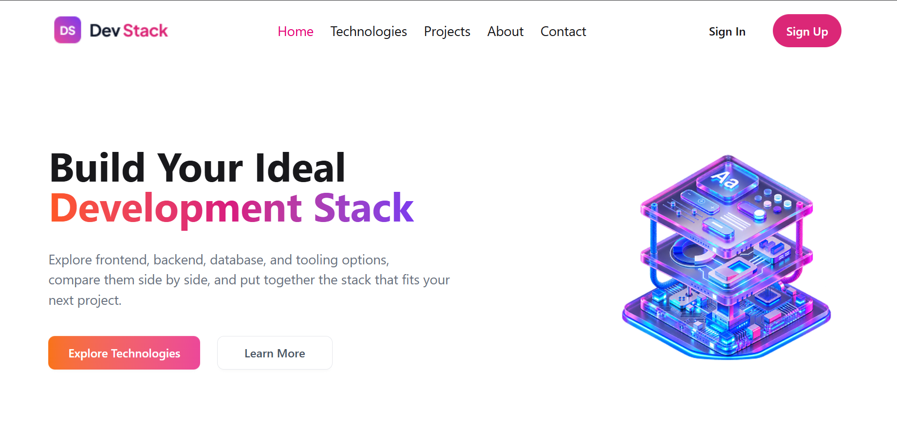
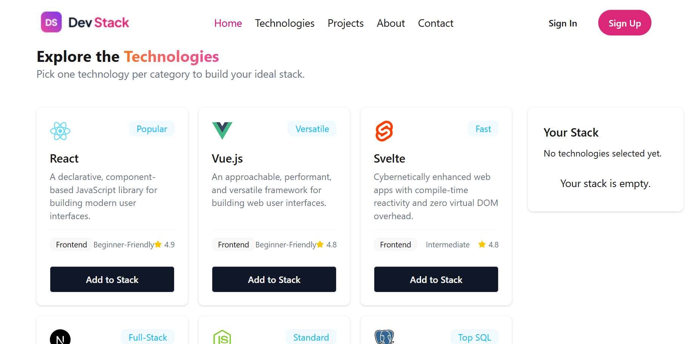
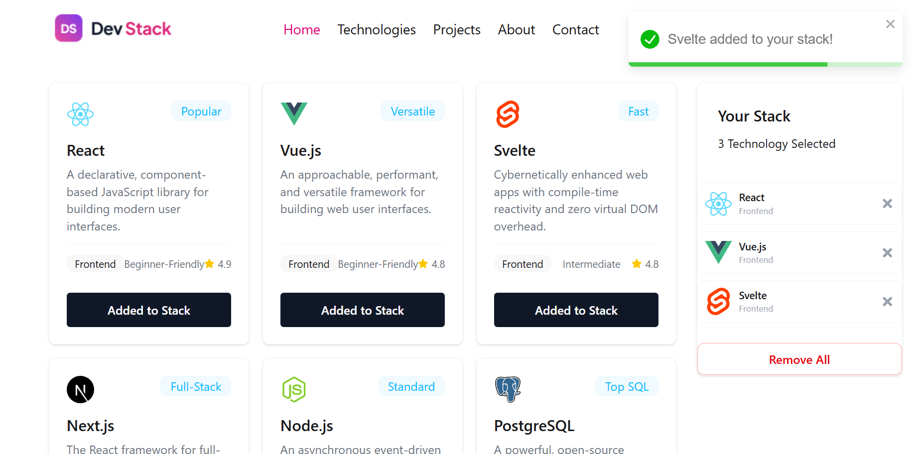
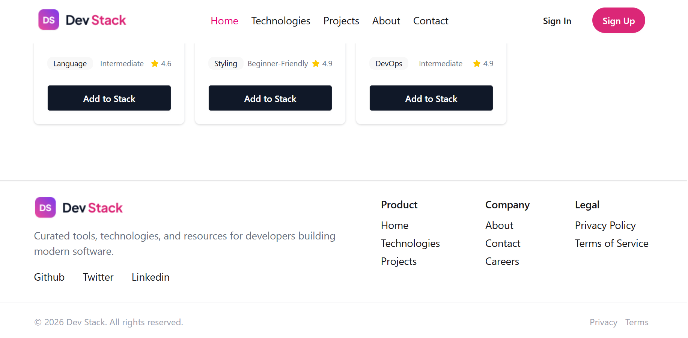

# Dev Stack

Build your ideal development stack, one technology at a time.

## 📖 About the Project

**Dev Stack** is a small web app that helps developers explore frontend, backend, database, language, and tooling options and put together the stack that fits their next project. Technologies are shown as cards with their category, difficulty, and rating. You pick the ones you like, and they collect in a "Your Stack" panel beside the grid.

The technology data is loaded from a local JSON file, so the whole app runs without a backend.

---

## 📸 Preview

### Header and Hero


### Technology Cards and Empty Stack


### Adding to the Stack


### Footer


---

## 🛠️ Technologies Used

| Technology | Purpose |
| --- | --- |
| **React 19** | Building the UI with components |
| **TypeScript** | Type safety for props, state, and data |
| **Vite** | Fast build tool and dev server |
| **Tailwind CSS v4** | Utility-first styling |
| **daisyUI** | Ready-made components (cards, buttons, badges) |
| **React Toastify** | Toast alerts for add, remove, and clear actions |
| **React Icons** | Star, remove (✕), and menu icons |
| **JSON** | Technology data stored in `public/data.json` |

---

## ✨ Features

1. **Build your own stack:** click "Add to Stack" on any technology card to add it to the "Your Stack" panel. The same technology can't be added twice, and once it is added, its button becomes disabled and reads "✓ Added to Stack".
2. **Manage your stack:** the panel shows how many technologies you have selected. Remove a single item with its ✕ button, or clear everything at once with "Remove All". When the stack is empty, a friendly empty message is shown.
3. **Instant feedback:** toast alerts tell you when a technology is added, when you try to add a duplicate, and when items are removed. A loading message shows while the JSON data is being fetched, and one shared gradient (orange → pink → violet) gives the whole UI its brand look.

---

## 📁 Project Structure

```
public/
  data.json              # technology data (12 items)
screenshots/             # images used in this README
src/
  assets/                # logo and banner images
  components/
    Navbar.tsx           # sticky navigation bar
    Banner.tsx           # hero section
    Technologies.tsx     # owns the selected-stack state
    Card.tsx             # grid of technology cards
    Stack.tsx            # "Your Stack" sidebar
    StackCard.tsx        # list of selected items + Remove All
    Footer.tsx
  types/
    technology.ts        # Technology type
  App.tsx
  main.tsx
  index.css
```

---

## 🚀 Getting Started

```bash
# clone the repository
git clone https://github.com/mihrub/DevStack-2026.git

# go into the project folder
cd DevStack-2026

# install dependencies
npm install

# start the development server
npm run dev
```

Build for production with `npm run build`.

---

## ❓ React Questions

### 1. What is JSX, and why is it used in React?

JSX is a way of writing HTML-like code inside JavaScript. React uses it so we can describe how the UI looks right next to the logic that controls it, instead of keeping them in separate files. The browser doesn't understand JSX, so a build tool turns it into normal JavaScript.

### 2. What is the difference between props and state?

Props are values a component receives from its parent, and the component can only read them, not change them. State is data a component owns and can update itself. When state changes, React re-renders the component. In short: props come from outside, state lives inside.

### 3. What does the `useState` hook do, and where did you use it in this project?

`useState` lets a component remember a value between renders and gives a function to update it. When that function is called, React re-renders with the new value. I used it in `Technologies.tsx` to keep the `selectedStack` list (the technologies the user added), and in `App.tsx` to create the data-fetching promise only once.

### 4. What does the `useEffect` hook do, and why did you need it to load the JSON data?

`useEffect` runs code after a component renders, which makes it the usual place for side effects like fetching data. The normal way to load JSON is to fetch it inside `useEffect` and store the result in state. In this project I used React 19's `use` hook together with `<Suspense>` instead: the fetch returns a promise, `use` waits for it, and Suspense shows the loading message in the meantime. It solves the same problem in a different way, without needing `useEffect` and a loading flag.

### 5. Why does every item in a `.map()` list need a unique `key` prop?

React uses the key to tell which list item is which. When the list changes (for example when I remove an item from the stack), the key lets React update only the changed item instead of rebuilding everything, and it keeps each item's state matched to the right element. Without a unique key, React can get confused and show wrong or stale items. I used `technology.id` as the key.

### 6. What is conditional rendering? Show one place you used it.

Conditional rendering means showing different UI depending on a condition. I used it in `Stack.tsx` for the empty message:

```tsx
{selectedStack.length === 0 ? (
  <div>Your stack is empty.</div>
) : (
  <StackCard ... />
)}
```

If nothing is selected, the empty message is shown. Once something is added, the list of items and the Remove All button appear instead. The "Add to Stack" button also changes its text to "✓ Added to Stack" in the same way.

### 7. How do you pass data from a parent component to a child component, and how does a child send something back to the parent?

A parent passes data to a child through props, like `<Card selectedStack={selectedStack} />`. A child can't change the parent's data directly. Instead, the parent passes down a function (or the state setter), and the child calls it to send something back. In this project `Technologies` passes `setSelectedStack` to `Card` and `Stack`. When the user clicks "Add to Stack" or ✕, the child calls that function, the parent's state updates, and everything re-renders.

---
